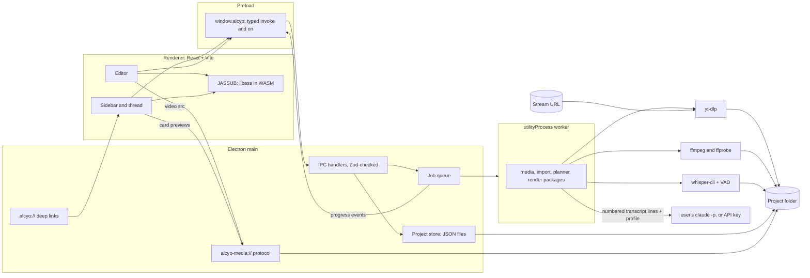

# Kiroween 2026 build plan: Alcyo Shorts (v3)

A Frankenstein entry: a desktop app for Mac and Windows. You paste a stream URL or drop in a file. The app transcribes it on your computer, finds the moments your viewers clipped, and Claude proposes shorts in a chat thread that already knows your style. You make follow-up edits by chatting, or open the editor for fine control. Everything is processed on your computer.

v3, Nov 1, 2026. This is the complete plan with every decision confirmed. It replaces v1 and v2. Agents read this file and nothing older.

---

## Contents

1. Decisions confirmed
2. What it is
3. The user flow
4. The app: a chat-first UI
5. Links and URLs
6. The editor
7. How things link
8. Scope and priorities
9. The Frankenstein pitch
10. Architecture
11. Import: files and URLs
12. Stream clips
13. Creator profile: onboarding, past videos and templates
14. Analysis pipeline
15. Local storage
16. Claude through Claude Code
17. Chat actions
18. Preview and render parity
19. Mac and Windows builds
20. Stack and versions
21. Repo layout
22. Data schema
23. Specs, in build order
24. Milestones to Dec 4
25. Steering files
26. Hook files
27. MCP config
28. How each Kiro feature is used
29. Judging and prizes
30. Judge test path
31. Submission checklist
32. Demo video outline
33. Things only you do
34. Rules for the agents
35. Open questions
36. Current status

---

## 1. Decisions confirmed

| Topic | Decision |
|---|---|
| Platform | Electron desktop app for macOS (Apple Silicon) and Windows 10/11 x64. |
| UI | Chat-first, in the style of Grok Bot: a sidebar of conversations and a chat thread with a message box. Each stream is a conversation. The full editor opens from a short. |
| Getting footage | Paste a URL (a YouTube or Twitch VOD, a clip, or a channel's clips page) or drop in a local file. URLs are fetched with a bundled, pinned yt-dlp. |
| Stream clips | Clips that viewers or the creator made during the stream are fetched by URL, matched to their place in the VOD, and used as strong signals when Claude picks shorts. |
| Past videos and templates | Local files: shorts the creator already posted, and template files (an Alcyo template, or an `.ass` caption style). The app learns the creator's style from them. |
| First run | After Claude Code is found and signed in, Claude asks the creator a short set of questions. The answers and the past-video analysis become a creator profile that goes into every prompt. |
| Follow-up edits | Core (P0). You type in the thread ("make the second one punchier", "find two more about the boss fight") and a new version comes back in the thread. |
| Links | Every stream, short and version has an in-app route and an `alcyo://` link. Copy link on any card; clicking an `alcyo://` link anywhere opens the app on that version. No local web server. |
| Claude | The user's own `claude -p`, billed to their Claude plan. Anthropic API key as a backup. |
| Storage | A project folder of JSON files on disk, one project per stream. No database, no cloud. |
| Privacy | Video and audio are never uploaded. Only transcript text goes to Claude. The only network traffic is downloading footage you asked for, the whisper model download, and Claude. |
| Built with | Kiro CLI V3 for most specs, the Kiro IDE for the schema spec. |
| Deadline | Dec 4, 2026, 2:00 PM PT. No extensions. |

---

## 2. What it is

Alcyo Shorts (working name) turns a long stream into posted-ready vertical shorts. You paste the stream's URL or drop in the recording. The app downloads it if needed, transcribes it on your computer, and finds the clips your viewers made while you were live. Claude, through the Claude Code you already have, reads the transcript with those clips marked and your creator profile attached, and proposes three shorts in a chat thread. Each short is a card you can play right in the thread. You ask for changes in plain words, or open the editor to cut by deleting words, fix captions, move the 9:16 frame and set the hook. Then you render 1080x1920 MP4s.

It is the single-user, local slice of the full Alcyo plan. Teams, sync, review and the cloud parts come later.

---

## 3. The user flow

1. **Setup, first run.** The setup screen finds `claude`, checks that it's signed in and recent enough, checks the bundled ffmpeg, ffprobe, whisper-cli, yt-dlp and VAD model, and downloads a whisper model (`small.en` on Apple Silicon, `base.en` on Windows). Each failed check says how to fix it.
2. **Onboarding, first run.** The creator drops in a few past shorts and any template files. The app analyzes them while Claude asks 5 to 8 questions in a chat thread: what they stream, who watches, their tone, words to avoid, how long their shorts run, what a good short looks like to them. The result is a creator profile they can read and edit in Settings.
3. **New stream.** Press + in the sidebar, or paste a URL into any message box. A stream conversation is created as a project folder, like `My Stream.alcyo`.
4. **Import.** A URL is downloaded into the project with progress. A local file is referenced in place unless you tick Copy into project. Clip URLs and a channel's clips page can be added to the same conversation.
5. **Analyze.** Progress shows in the thread as a status message: audio, silences, transcript in chunks, clip matching. Find shorts unlocks as soon as the transcript is in. Proxies, waveform and thumbnails keep building in the background.
6. **Claude proposes three shorts.** Claude's message has three short cards: a playable 9:16 preview, the hook title, the reason, the length, and whether viewers clipped that moment. Each is version 1 of its short.
7. **Follow-up edits in the thread.** Reply to a card, or type into the thread. Claude returns a new version, shown as a new card with what changed. One click goes back to any earlier version.
8. **Fine edits in the editor.** Open a card in the editor for timeline, transcript, caption, crop and hook edits. Saving makes a new version, and a short message in the thread links to it.
9. **Render.** Press Render on a card or in the editor. Progress shows on the card and in the render queue, a notification fires when it's done, and Show in Finder or Explorer opens the file.

---

## 4. The app: a chat-first UI

The layout follows the Grok Bot screenshot: dark, soft, rounded, and calm.

### Sidebar (left, about 340 px)

- Top: search and + (new stream) buttons.
- Top center: the creator's avatar and name from the profile, like the "Jarvis" header.
- List: one row per stream conversation, newest activity first. Each row has a round thumbnail (a frame from the stream), the stream's name, a one-line preview of the last message, and a blue dot when something finished while you were elsewhere (analysis done, render done).
- Pinned at the bottom: the creator's name and avatar (opens Settings and the profile), and a grid button for the render queue.

### Thread (right)

- Header: the stream name with its thumbnail in a floating pill, like "Engineer" at the top of the screenshot. Clicking it shows the source, its length, its link and its clips.
- Messages: user messages are right-aligned light-grey bubbles; Claude's and the app's messages are left-aligned dark bubbles. Rounded corners about 22 px, generous padding, 17 px text.
- Message types:
  - **Text** from the creator or Claude.
  - **Status**: analysis or download progress, updated in place, collapsing to one line when done.
  - **Short card**: a 9:16 preview player (poster frame, plays inline with captions and crop), title, hook, reason, length, a "clipped by viewers" badge when it overlaps a clip, a version chip (`v1 · Claude`), and buttons: Open editor, Render, Copy link, More (versions, reveal in source).
  - **Version card**: a new version of a short, with the change summary ("Cut the intro, new hook") and a Restore earlier button.
  - **Render card**: progress, then the file with Show in Finder or Explorer and Copy path.
  - **Question**: during onboarding, Claude's questions with quick-reply chips where it helps.
- Composer at the bottom: + to attach a file or paste a URL, a text box that says "Message <stream name>", and send. Replying to a card puts a small quote of it above the box, so the edit goes to that short. A mic button is stretch.
- Links inside messages: short and version chips are links. Clicking scrolls to the card or opens it.

### Other screens

Editor (full window, from a card), Render queue, Settings (profile, Claude, models, encoder, storage), Setup, Onboarding (a special thread). All use the same dark theme.

### Visual system

- Background `#0B0B0B`, sidebar `#0F0F0F`, Claude bubble `#1C1C1C`, user bubble `#2A2A2A`, hairlines `#FFFFFF14`, text `#F5F5F5`, secondary text `#A3A3A3`, unread dot `#3B82F6`.
- System font stack (SF Pro on Mac, Segoe UI Variable on Windows), 17 px body, 15 px secondary.
- Light theme is stretch.

---

## 5. Links and URLs

Everything has an address, and the same address works inside the app and from outside.

| What | In-app route | `alcyo://` link |
|---|---|---|
| A stream thread | `/s/<streamId>` | `alcyo://s/<streamId>` |
| A message | `/s/<streamId>#m-<messageId>` | `alcyo://s/<streamId>/m/<messageId>` |
| A short (latest version) | `/s/<streamId>/short/<shortId>` | `alcyo://s/<streamId>/short/<shortId>` |
| A version | `/s/<streamId>/short/<shortId>/v/<n>` | `alcyo://s/<streamId>/short/<shortId>/v/<n>` |
| The editor | `/s/<streamId>/short/<shortId>/v/<n>/edit` | `alcyo://.../v/<n>/edit` |
| A moment in the source | `/s/<streamId>/source?t=<ms>` | `alcyo://s/<streamId>/source?t=<ms>` |
| Render queue, settings | `/renders`, `/settings`, `/settings/profile` | same |

- Routing uses TanStack Router with hash history inside the window.
- `alcyo://` is registered with `app.setAsDefaultProtocolClient`. macOS delivers it through `open-url`; Windows through `second-instance` argv. The app is single-instance (`requestSingleInstanceLock`).
- Links are parsed with a Zod schema before navigating. Unknown or malformed links show "That link doesn't point to anything in this app."
- Stream ids are stable per project and recorded in a recent-projects index in userData, so a link opens the right folder. If the folder moved, the app asks you to locate it.
- Copy link on any card copies the `alcyo://` link. Paste it into Notes, Slack or a doc, and clicking it opens that version.
- This is not a localhost web server. A local server would let any program on the computer reach the project files. Routes plus `alcyo://` give the same linking without that risk.

---

## 6. The editor

Opens from a short card. Three panes: the 9:16 preview on top, the transcript of the short beside it, and the timeline along the bottom. A slim chat drawer on the right keeps the thread one click away, so you can type a follow-up without leaving.

| Priority | Feature | What it does |
|---|---|---|
| P0 | Preview player | Plays the short's proxy (or the source, when it plays directly) through `alcyo-media://`, with two video elements swapping at cuts. Crop is a CSS transform; captions and hook are drawn by JASSUB from the same `.ass` the render uses. |
| P0 | Timeline | Tracks for video segments, captions, hook text and crop keyframes, with waveform and thumbnails. Zoom, and snapping to words, pauses and the playhead. |
| P0 | Trim, split, ripple delete | Drag segment edges, split at the playhead, delete a range and close the gap. |
| P0 | Transcript editing | Select words and press Delete to cut them. Cut words show struck through and can be restored. |
| P0 | Captions | Built from kept words. Edit a word's text, hide a word from captions, nudge timing, set words per line. |
| P0 | Caption presets | Bold pop and Clean, plus the creator's own presets from templates. |
| P0 | 9:16 reframe | Drag the 9:16 window over the source. Hold or linear keyframes at the playhead, draggable on the timeline. |
| P0 | Hook text | Text with start, end and a style, plus safe-area guides. |
| P0 | Versions | Per-short list with who made each version and when. Open, restore, or branch from any version. |
| P0 | Undo and redo | Every edit, including a Claude revision, at least 200 steps. |
| P0 | Chat drawer | The stream's thread beside the editor. A follow-up sent from here targets the open short. |
| P1 | Filler finder | Marks um, uh and repeats, with Cut all and per-word restore. |
| P1 | Scene-cut keyframes | One button adds a hold keyframe at each scene cut. |
| P1 | Source view | The full VOD with transcript search, pauses, scene cuts, clips and existing shorts. Make a short from a selected range. |
| P1 | Boxed and Minimal presets, 60 fps, loudnorm | More looks and export options. |

### Keyboard shortcuts (P0)

| Key | Action |
|---|---|
| Space | Play or pause |
| J / K / L | Back, pause, forward; press again to speed up |
| Left / Right | One frame; with Shift, one second |
| I / O | Set in or out at the playhead |
| S | Split at the playhead |
| Delete | Ripple delete the selection |
| Cmd/Ctrl+Z, Shift+Cmd/Ctrl+Z | Undo, redo |
| Cmd/Ctrl+S | Save version |
| Cmd/Ctrl+Enter | Render |
| Cmd/Ctrl+K | Focus the chat box |
| Cmd/Ctrl+Shift+C | Copy link to this version |
| + / - | Zoom the timeline |
| ? | Show all shortcuts |

---

## 7. How things link

One edit shows up everywhere it should, because every piece points at the same source times (integer ms), word ids and version numbers.

| Link | What you see |
|---|---|
| Word to time | Click a word and the player seeks there. The current word is highlighted while playing. |
| Transcript to cut | Selecting words selects that range on the timeline, and the other way round. |
| Captions to transcript | Each caption word points at a transcript word id. Fixes are overrides; the transcript is never changed. |
| Clip to source | Each matched clip shows as a range on the source timeline, and a card says when a short overlaps one. |
| Short to source | Every segment shows its VOD timecode. Reveal in source jumps there. |
| Message to version | Every version card in the thread links to its version, and every version records the message that asked for it. |
| Short to version | The editor header says which version you're on and what it came from ("Claude v2, from your message 'make it punchier'"). |
| Render to version | Each render records the version and preset. Rendering an unsaved draft saves a version first. |
| Preview to render | The preview and the render share the crop function and the `.ass` file. |

---

## 8. Scope and priorities

### P0: the demo path

Setup, onboarding interview, past-video analysis, URL and file import, clip matching, analysis, the chat-first app with short cards and inline preview, three proposals, follow-up edits in chat, routes and `alcyo://` links, the editor's P0 features, render queue, the demo project, Mac and Windows packages.

### P1: after the vertical slice renders on both OSes

Filler finder, scene-cut keyframes, source view, `[loud]` and `[scene]` hints, Boxed and Minimal presets, 60 fps, loudnorm, Clear cache, importing a channel's whole clips page in one paste.

### Stretch

- Side-by-side compare of two versions.
- Intro and outro clips from a template.
- Blurred background fill for sources narrower than 9:16.
- Voice input in the composer.
- Light theme.
- Windows GPU transcription (Vulkan whisper.cpp).
- An Intel Mac build.
- A Kiro power that packages the MCP server and ffmpeg notes.

### Out, and why

- Accounts, Convex, Better Auth, R2, the remote MCP connector: full Alcyo. This build has zero cloud.
- Platform logins (Twitch or YouTube OAuth): yt-dlp fetches public URLs, so no login is needed. Private or subscriber-only VODs are out.
- Comments, approvals, roles: team features.
- Face or speaker tracking: keyframes plus scene-cut suggestions cover it.
- Auto-posting: app reviews and platform terms. You post by hand.
- Stream Deck marks and the phone app: full Alcyo.
- A local LLM: doubles the prompt work.
- A Claude login inside Alcyo: not allowed for third-party apps. Sign-in stays in Claude Code.
- Reordering segments inside a short: cuts stay in source order.
- A localhost web server: see section 5.

---

## 9. The Frankenstein pitch

Parts from different worlds, stitched into one app:

- yt-dlp, a community downloader, pulling a stream and its viewer clips from a URL.
- whisper.cpp, a C++ port of a speech model, on the Mac's GPU or a Windows CPU, with Silero VAD skipping the silence.
- ffmpeg, a command-line tool first released in 2000, doing every cut, crop and caption.
- libass, compiled to WASM in the preview and native inside ffmpeg in the render, drawing the same caption file in both.
- Claude, reached through the user's own Claude Code CLI, seeing only numbered lines of text, answering with ids.
- A chat app's interface on top of a video editor, so editing a video feels like texting.

The idea that holds it together: the LLM writes a plan, not commands. You change the plan by chatting or by hand. Code checks it, and a deterministic renderer carries it out.

Draft for the "what are you building" form:

```
Frankenstein. A desktop app for Mac and Windows that turns a long stream into
captioned vertical shorts. Paste the stream's URL: yt-dlp fetches it and the
clips your viewers made, whisper.cpp transcribes it on your computer, and
Claude (through your own Claude Code) picks shorts in a chat thread that knows
your style. Ask for changes like you'd text an editor, or fine-tune in a
transcript-linked editor. ffmpeg renders it. Your footage never leaves your
computer.
```

---

## 10. Architecture



- **Main.** Owns the file system, the project store, the job queue, the `alcyo-media://` protocol and `alcyo://` deep links. Every IPC input is parsed with Zod.
- **Worker.** One Electron `utilityProcess` runs jobs: it spawns yt-dlp, ffmpeg, ffprobe, whisper-cli and claude, and does heavy parsing. It talks to main over a typed, Zod-checked MessagePort contract.
- **Preload.** Exposes only `window.alcyo` with `invoke` and `on`, typed from `packages/ipc`.
- **Renderer.** The React app: sidebar, thread, editor. Editor state lives in zustand with snapshot undo. It plays video from `alcyo-media://`, draws captions with JASSUB, and never touches files. It may import the pure packages (`schema`, `render/crop`, `render/ass`).
- **Jobs.** Download, analysis steps, model download, Claude calls and renders are jobs with an id, stages, percent and cancel. Each job posts and updates a status message in its stream's thread. Transcription and render run one at a time; background steps pause while a render runs.

### Typed IPC

```ts
// packages/ipc/src/contract.ts
export const contract = {
  "setup:check":         { input: z.object({}), output: SetupReport },
  "setup:locateClaude":  { input: z.object({ path: z.string() }), output: ClaudeCheck },
  "model:download":      { input: z.object({ model: WhisperModel }), output: JobRef },

  "profile:get":         { input: z.object({}), output: CreatorProfile.nullable() },
  "profile:save":        { input: z.object({ profile: CreatorProfile }), output: z.object({}) },
  "profile:addSamples":  { input: z.object({ paths: z.array(z.string()).max(50) }), output: JobRef },
  "profile:addTemplate": { input: z.object({ path: z.string() }), output: Template },

  "streams:list":        { input: z.object({}), output: z.array(StreamSummary) },
  "stream:create":       { input: z.object({ name: z.string().min(1).max(120), dir: z.string().optional() }), output: StreamSummary },
  "stream:open":         { input: z.object({ streamId: Id }), output: Project },
  "stream:openDemo":     { input: z.object({}), output: StreamSummary },

  "source:importFile":   { input: z.object({ streamId: Id, path: z.string(), copy: z.boolean() }), output: JobRef },
  "source:importUrl":    { input: z.object({ streamId: Id, url: HttpUrl }), output: JobRef },
  "source:relink":       { input: z.object({ sourceId: Id, path: z.string() }), output: Source },
  "clips:addUrls":       { input: z.object({ streamId: Id, urls: z.array(HttpUrl).min(1).max(100) }), output: JobRef },

  "analysis:start":      { input: z.object({ sourceId: Id }), output: JobRef },
  "transcript:window":   { input: z.object({ sourceId: Id, fromMs: Ms, toMs: Ms }), output: TranscriptWindow },
  "transcript:search":   { input: z.object({ sourceId: Id, query: z.string().max(200) }), output: z.array(LineHit) },

  "thread:messages":     { input: z.object({ streamId: Id, before: Id.optional(), limit: z.number().int().max(200) }), output: z.array(Message) },
  "thread:send":         { input: z.object({ streamId: Id, text: z.string().min(1).max(2000), replyTo: ShortRef.optional() }), output: JobRef },

  "short:get":           { input: z.object({ shortId: Id, version: z.number().int().optional() }), output: ShortVersion },
  "short:saveDraft":     { input: z.object({ shortId: Id, short: Short }), output: z.object({}) },
  "short:saveVersion":   { input: z.object({ shortId: Id, note: z.string().max(200) }), output: ShortVersion },
  "short:versions":      { input: z.object({ shortId: Id }), output: z.array(VersionSummary) },
  "short:restore":       { input: z.object({ shortId: Id, version: z.number().int() }), output: ShortVersion },
  "short:ass":           { input: z.object({ shortId: Id, short: Short }), output: z.object({ ass: z.string() }) },

  "render:enqueue":      { input: z.object({ shortId: Id, version: z.number().int(), presetId: Id }), output: JobRef },
  "job:cancel":          { input: z.object({ jobId: Id }), output: z.object({}) },
  "link:copy":           { input: AppLink, output: z.object({ url: z.string() }) },
  "shell:reveal":        { input: z.object({ renderId: Id }), output: z.object({}) },
} as const;
// Events, main -> renderer:
//   job:progress { jobId, kind, stage, pct }, job:done, job:failed
//   thread:message { streamId, message }       new or updated message
//   streams:changed                            sidebar refresh, unread dots
//   link:open { link: AppLink }                an alcyo:// link arrived
```

---

## 11. Import: files and URLs

### Local files

Drop a file on the thread or use + then Choose file. It is referenced in place, with a fingerprint, unless Copy into project is ticked. Nothing is written next to it.

### URLs

Paste any `http(s)` URL into the composer or + then Paste link. The app asks yt-dlp what it is before downloading:

| What yt-dlp reports | What happens |
|---|---|
| A single video over 10 minutes | Imported as the stream's source. |
| A single video under 10 minutes, or a known clip URL | Added as a clip of this stream (section 12). If the stream has no source yet, the app asks: "Use this as the stream, or add it as a clip?" |
| A playlist or clips page | Lists the entries in a message with checkboxes. Selected entries are added as clips (P1 for whole pages). |
| Not supported, private, or needs a login | One line: "That link can't be downloaded. If it's private, download it yourself and drop the file in." |

The download:

```ts
spawn(ytDlpPath, [
  "--no-playlist",
  "--no-config",                    // ignore the user's yt-dlp config
  "--no-cache-dir",
  "--ffmpeg-location", ffmpegDir,   // the bundled ffmpeg
  "-f", "bv*[height<=1080]+ba/b[height<=1080]",
  "--merge-output-format", "mp4",
  "--write-info-json",
  "--newline", "--progress-template", "%(progress._percent_str)s",
  "-o", path.join(sourceDir, "media.%(ext)s"),
  "--", url,                        // "--" so a URL can't be read as a flag
], { cwd: sourceDir });
```

- Downloads land in the project's `sources/<id>/` folder (a URL import is always a copy). The info JSON keeps the title, uploader, upload date, duration and URL; the app reads it with Zod.
- 1080p cap: shorts render at 1080x1920, so higher sources only cost time and disk.
- yt-dlp is pinned with a checksum like the other binaries. Sites change often and an old yt-dlp stops working, so Settings has "Update downloader", which fetches the latest release from yt-dlp's GitHub, verifies its published SHA-256, and keeps the pinned one as a fallback.
- The first URL import shows a one-time note: "Only download videos you own or have permission to use."
- Cancel kills yt-dlp and removes partial files.

---

## 12. Stream clips

Clips are short pieces of the stream that viewers or the creator cut while live. They show what the audience reacted to, which makes them the best signal for picking shorts.

### Adding clips

- Paste one or more clip URLs (Twitch clips, YouTube clips, or any short video) into the thread.
- Drop local clip files.
- P1: paste a channel's clips page and pick from the list.

### Matching a clip to the VOD

Platform metadata about where a clip sits in the VOD is inconsistent, so the app finds it from the content itself:

1. Transcribe the clip (it's short, so this takes seconds).
2. Find the clip's words in the VOD transcript with a fuzzy text search over word windows. This gives a candidate offset.
3. Refine with audio: cross-correlate a 16 kHz mono envelope of the clip against the VOD's audio around the candidate, within ±5 s. This gives the offset to about 20 ms.
4. If the clip has no speech, skip to audio matching over the whole VOD using a coarse envelope first.
5. Save a `ClipMatch` with the VOD range, the confidence and the method. Low-confidence matches show as "Couldn't place this clip" with a Place by hand option in the source view.

If yt-dlp's info JSON for a clip includes a VOD offset, it is used as the starting candidate, and matching only confirms it.

### How clips are used

- In Claude's prompt, lines inside a clip are marked `[clipped]`, or `[clipped x3]` when several clips overlap.
- Short cards show a "Clipped by viewers" badge when they overlap a clip.
- The source timeline shows clips as ranges.
- A clip can become a short directly: "Make this clip a short" on a clip message.

---

## 13. Creator profile: onboarding, past videos and templates

The profile is what makes the first proposal sound like the creator. It lives in userData as `profile.json`, is editable in Settings, and goes into every Claude prompt.

### Onboarding interview

Runs after setup passes, as a special thread. Claude asks 5 to 8 questions, one at a time, with quick-reply chips where answers are predictable:

- What do you stream, and who watches?
- What makes a moment worth a short for you? (funny, skill, rage, wholesome, story, info)
- How long are your shorts usually? (chips: 15 to 30 s, 30 to 45 s, 45 to 60 s)
- How do you title them? Paste two or three titles you liked.
- Any words, topics or people to keep out of shorts?
- Where do you post? (TikTok, YouTube Shorts, Reels: sets safe areas)
- Caption look: four live previews to pick from, or "use my template".

Claude can ask a follow-up when an answer is vague, and stops after 8 questions. The interview uses the same `claude -p` call as everything else, with a schema that returns either the next question or the finished profile draft. Skipping is allowed; every question has a default.

### Past videos

The creator drops in shorts they've already posted (up to 50). For each, the worker runs ffprobe, a transcript, silences and scene cuts, and code measures:

| Measure | From |
|---|---|
| Length | ffprobe |
| Time to first word, and the first sentence | transcript |
| Words per second | transcript |
| Cuts per 10 s | scene cuts plus jump cuts found as gaps in continuous speech |
| Pause handling | silences longer than 300 ms that remain |
| Loudness | ebur128 integrated loudness |
| Burned-in caption presence | text detected in frames is out of scope; the interview's caption question covers style |

Claude gets the transcripts of the openings plus these numbers, and writes a style summary ("Opens on the reaction, then rewinds 3 s. Short punchy titles in caps. Cuts every pause.") with the numbers as targets. The creator can edit the summary.

### Templates

- **Alcyo template** (`*.alcyo-template.json`): caption preset, hook preset, target length, title rules, safe area. Export one from Settings, share it with an editor, import it on another machine.
- **`.ass` file**: the app imports the `[V4+ Styles]` section as caption and hook presets. Fonts named in it are checked against the bundled fonts; a missing font falls back with a note.
- Templates appear as presets in the editor and in the onboarding caption question.

### What goes to Claude

```
# Creator profile
Streams: Minecraft hardcore and chat hangouts, viewers 16 to 24.
Good moments: funny, rage, close calls. Not: long explanations.
Length: 25 to 40 s. Titles: short, caps, no emoji. Example: "HE DID NOT SEE THAT"
Avoid: real names of friends off stream, sponsor mentions.
Style from 12 past shorts: opens on the reaction within 1.5 s; 3.1 words/s; a cut every 2.4 s; pauses over 300 ms removed.
```

Text only. No video, audio or images of past shorts go to Claude.

---

## 14. Analysis pipeline

Each step has inputs, an output file and a cache key (source fingerprint, step settings, tool version). A step whose key matches is skipped.

| # | Step | Needs | Output | Notes |
|---|---|---|---|---|
| 1 | Probe | source | `source.json` | ffprobe: duration, streams, fps, codec, whether Chromium plays it directly. |
| 2 | Audio | 1 | `cache/<id>/audio.wav` | 16 kHz mono 16-bit WAV. |
| 3 | Silences | 2 | `silences.json` | `silencedetect`. |
| 4 | Chunks | 3 | in memory | Split at silences about every 10 minutes. |
| 5 | Transcript | 2, 4 | `transcript.json` | whisper-cli per chunk: `--vad -vm <silero>`, `-ojf`, `--dtw <model>`. Tokens merged into words, words into lines of at most 12 s. Each finished chunk is saved, so a crash resumes. |
| 6 | Clip matching | 5, clips | `clips.json` | Section 12. Reruns when clips are added. |
| — | **Find shorts unlocks** | 5, 6 | | Claude runs automatically once, then on request. |
| 7 | Loudness | 2 | `loudness.json` | `ebur128` momentary. P1 hints. |
| 8 | Scenes | 1 | `scenes.json` | `select='gt(scene,0.3)',showinfo` on a low-res decode. Background. |
| 9 | Per-short proxies | 1, shorts | `cache/<id>/short-<shortId>.mp4` | Only when the source can't play directly. Range plus 30 s each side. |
| 10 | Full proxy | 1 | `cache/<id>/proxy.mp4` | Background. 720p, keyframe every second, AAC. |
| 11 | Peaks | 2 | `cache/<id>/peaks.bin` | Min/max at 100 per second, Int8. |
| 12 | Thumbnails | 1 | `cache/<id>/thumbs-NNN.jpg` | One frame every 5 s; the first good one becomes the sidebar thumbnail. |

- Proxy encoder: a 1-second test encode picks the first that works from `h264_videotoolbox`, `h264_nvenc`, `h264_qsv`, `h264_amf`, `h264_mf`, then libx264 `veryfast`. Saved per machine.
- Word timing: spec 3 measures DTW word times against hand-marked times on the demo clip and records median and worst drift. Above 80 ms, cut points use the nearest silence edge within 150 ms.
- If `--dtw` doesn't work with flash attention on the pinned whisper.cpp, pass `-nfa`. Spec 3 checks.

---

## 15. Local storage

**JSON files, not SQLite.** better-sqlite3 is a native module rebuilt per Electron version, OS and CPU, which adds risk to both builds from day one. The data is small, versions are naturally one immutable file each, and the demo project can sit in the repo and be read by a person.

```
My Stream.alcyo/
  project.json            streamId, name, schemaVersion, sources, shorts index, settings
  thread/
    messages.jsonl        one Message per line, append-only; status updates append a new revision
  sources/<sourceId>/
    source.json           kind (file | url), path, url, info (from yt-dlp), fingerprint, ffprobe
    media.mp4             only for URL imports or Copy into project
    analysis/
      transcript.json     words: id, text, startMs, endMs, p; lines: id, startMs, endMs, wordIds
      silences.json  scenes.json  loudness.json  steps.json
  clips/<clipId>/
    clip.json             url or path, title, creator, info, match (range, confidence, method)
    media.mp4             downloaded clip
  shorts/<shortId>/
    short.json            status, head version
    draft.json            autosaved working copy
    versions/
      0001.claude.json    Claude's proposal, kept forever
      0002.claude.json    "make it punchier", with the message id that asked for it
      0003.user.json      your editor changes
  renders/
    index.json            render id -> short, version, preset, file, ffprobe summary
    <title>-v3-1080p30.mp4
  cache/                  safe to delete, rebuilt on demand
  logs/                   job logs, no keys, no transcript text

userData/
  settings.json           claude path, model, encoder, yt-dlp version, theme
  profile.json            creator profile
  templates/              imported templates
  streams.json            streamId -> folder, name, thumbnail, last activity, unread
  models/                 whisper models
  samples/                analysis of past shorts (not the videos)
```

- Atomic writes: temp file in the same folder, fsync, rename. On Windows, retry the rename on `EPERM`/`EBUSY` for up to 2 s. `messages.jsonl` is append-only, with a full line per write, and a torn last line is dropped on read.
- Every read is parsed with Zod. A bad file is kept as `.bad` and the app says which file and why.
- Fingerprint: size, first and last 4 MB, ffprobe duration and stream layout.
- Autosave writes `draft.json` within 1 s of an edit; reopening after a crash restores it.
- Versions are immutable and record their parent, who made them, and the message id for chat edits.
- Past-short videos are never copied; only their analysis is kept.

---

## 16. Claude through Claude Code

Users have Claude Code installed and signed in. The worker runs their `claude` command, so their Claude plan pays. Alcyo never sees their login.

| Provider | When | Who pays |
|---|---|---|
| `claude-cli` | Default | The user's Claude plan |
| `anthropic-api` | Chosen in Settings, or automatically when `claude` is missing and a key is set | The user's API key |
| `fake` | Tests only | Nobody |

```ts
// packages/planner/src/llm/provider.ts
export interface LlmProvider {
  readonly name: "claude-cli" | "anthropic-api" | "fake";
  // Returns the structured output, or throws PlannerError. The planner checks it with Zod.
  complete(req: {
    instruction: string;
    input: string;        // profile, numbered transcript lines, thread context
    jsonSchema: object;
    signal: AbortSignal;
  }): Promise<unknown>;
}
```

### Finding `claude`

A Mac app opened from Finder or the Dock doesn't get the terminal's PATH. On this machine `claude` is at `~/.local/bin/claude`, which a Finder-launched app won't see. The resolver tries, in order, and saves the first that works:

1. The saved path, if it still runs.
2. Known folders. macOS: `~/.local/bin/claude`, `~/.claude/local/claude`, `/opt/homebrew/bin/claude`, `/usr/local/bin/claude`. Windows: `%USERPROFILE%\.local\bin\claude.exe`, the WinGet links folder, and `where.exe claude` through `execFile`.
3. macOS only: `execFile(process.env.SHELL ?? "/bin/zsh", ["-ilc", "command -v claude"])`, 5 s timeout.
4. A Locate claude button.

"Works" means `claude -v` exits 0 with at least the minimum version set in spec 5.

### The call

```ts
const env = { ...process.env };
delete env.ANTHROPIC_API_KEY;      // bill the user's Claude plan, not a key
delete env.ANTHROPIC_AUTH_TOKEN;

const child = spawn(claudePath, [  // claude.exe on Windows
  "-p",
  "--output-format", "json",
  "--json-schema", JSON.stringify(jsonSchema),
  "--safe-mode",                   // no user hooks, plugins, MCP servers or CLAUDE.md; login still works
  "--tools", "",
  "--disallowedTools", "mcp__*",
  "--max-turns", "3",
  "--no-session-persistence",
  "--model", settings.model,
  instruction,
], { env, cwd: emptyTempDir });

child.stdin.end(input);

// Cancel: SIGINT, then SIGTERM after 5 s.
// Result: parse stdout as JSON; use `structured_output`. Missing, or `is_error` true, is a failed attempt.
```

- If `--safe-mode` is rejected with `-p` on the installed version, use `--strict-mcp-config` with no config plus `--setting-sources project` (the cwd is empty). Spec 5 tests this and records it.
- Never `--bare`: it doesn't read OAuth or the keychain, so it can't use the Claude plan.
- These flags are documented in the [CLI reference](https://code.claude.com/docs/en/cli-reference) and [headless docs](https://code.claude.com/docs/en/headless). Zod checks every answer; a bad answer gets one retry with the errors.
- The empty temp cwd keeps a project's `.claude/settings.json`, `.mcp.json` and CLAUDE.md from loading. `-p` runs those without a trust prompt.
- Setup runs `claude auth status` with the API key removed. Exit 0 means signed in.
- On Windows, only `claude.exe` is spawned. An npm `.cmd` shim gets "Install the native Claude Code" instead of a shell fallback.
- Alcyo never offers a Claude login, never reads Claude's Keychain entry or `~/.claude`, never stores or passes Claude tokens. The backup key is encrypted with Electron safeStorage.

### What Claude sees for Find shorts

```
# Creator profile
<section 13>

# Stream: My Stream, 2:58:14, from youtube.com, uploaded 2026-10-30. 7 viewer clips matched.
# Pick 3 shorts, each 25 to 40 s.
L0001 00:00:04 alright we're live, chat, give me one sec
L0002 00:00:09 [pause] okay so today we're finally doing the
...
L0412 01:23:45 [clipped x3] NO WAY, did you see that
L0413 01:23:48 [clipped x3] that's the third time this run
```

- One line per transcript line with its start time. The answer uses line ids.
- Prompt size is estimated at characters / 4. Over 150k tokens, overlapping windows of about 100k each return up to 5 candidates, and one more call picks three. Clipped lines are always kept in every window's context.

### What code does with the answer

1. Zod-check it.
2. Map line ids to the first word's start and the last word's end.
3. Snap edges to the nearest pause within 1.5 s.
4. Check length against the profile's range and that shorts don't overlap. Failures go back once.
5. Save version 1 of each, with captions from kept words and the profile's caption preset.
6. Post a Claude message with the three cards.

### Why Claude Code and not an in-app login

The Agent SDK overview says third-party developers can't offer claude.ai login unless Anthropic approved it. The legal page lets users sign in to the unmodified Claude Code binary with their own subscription. Anthropic's help article says `claude -p` draws from subscription limits. No page says word for word that a local tool may call the user's `claude`; it leans allowed, and T3 Code works the same way. If Anthropic publishes guidance against it, switch the default to the API key provider.

---

## 17. Chat actions

A message in a stream thread becomes exactly one action. Claude chooses the action from a fixed list and returns structured data; code carries it out. Claude never runs anything.

| Action | Example message | What code does |
|---|---|---|
| `revise_short` | "make the second one punchier", or any reply to a card | Sends that short's current version and its transcript window with word ids. Claude returns `keep` ranges of word ids, title, hook, and what changed. Saved as a new Claude version; a version card is posted. |
| `new_shorts` | "find two more about the boss fight" | Find shorts with the request and the existing shorts excluded. New cards are posted. |
| `retime_short` | "start it 3 seconds earlier" | Claude returns a new start or end line or word id. Applied, checked, saved. |
| `set_style` | "use bigger captions on all of these" | Claude picks a preset id and a scope (this short or all). Applied as new user-style versions. |
| `answer` | "why did you pick the first one?" | A text reply. Nothing changes. |
| `clarify` | an ambiguous request | Claude asks one question back. |

- The thread context sent with each message: the profile, the last 20 messages (text only), the list of shorts with their latest version's title, range and line ids, and, for `revise_short`, the target's window.
- The reply-to quote decides the target short. Without one, Claude names a short id from the list, and code checks it exists.
- Every action that changes a short records the message id in the new version.
- The schema is one discriminated union (`ChatAction`, section 22). Unknown actions fail the schema and get one retry.

---

## 18. Preview and render parity

| Part | Shared how |
|---|---|
| Crop | `cropWindow(keys, tMs, srcW, srcH)` in `packages/render/src/crop.ts`, pure. The preview uses it for a CSS transform; the render engine turns the same keys into an ffmpeg `crop` x expression. |
| Captions and hook | `buildAss(short, transcript, preset)` in `packages/render/src/ass.ts`. The preview hands it to JASSUB; the render burns it with `subtitles=...:fontsdir=<bundled fonts>`. |
| Fonts | `resources/fonts/`, OFL. JASSUB loads them from `alcyo-media://fonts/`; ffmpeg from `fontsdir`. No system fonts. |

- Playback across cuts: two `<video>` elements. While A plays segment *n*, B is seeked to segment *n+1*. `requestVideoFrameCallback` swaps them at the end. If B isn't ready, the last frame holds up to 200 ms.
- Short cards in the thread use the same player in a compact mode, loading only when scrolled into view, and only one plays at a time.
- CSP: `script-src 'self' 'wasm-unsafe-eval'; worker-src 'self' blob:`. JASSUB falls back to single-threaded without cross-origin isolation, which is fine here.
- Tests: crop offsets from ffmpeg single frames vs `cropWindow` (±1 px); JASSUB `manualRender` frame vs ffmpeg frame of the same caption (pixel-diff threshold), in Playwright on both OSes.

---

## 19. Mac and Windows builds

| Part | macOS (arm64) | Windows (x64) |
|---|---|---|
| Installer | dmg, electron-builder | nsis, electron-builder |
| whisper-cli | Built from a pinned whisper.cpp tag with CMake; Metal on Apple Silicon | `whisper-bin-x64.zip` from the matching release (CPU) |
| yt-dlp | `yt-dlp_macos` from the pinned release, checksum verified | `yt-dlp.exe` from the pinned release |
| VAD model | Silero, about 865 KB, bundled | Same |
| ffmpeg, ffprobe | Pinned static arm64 build with libass, libx264, VideoToolbox | Pinned static build from gyan.dev with libass, libx264, NVENC/QSV/AMF/MF |
| Whisper model | `small.en` default, downloaded on first run, SHA-1 checked | `base.en` default |
| `alcyo://` | `protocols` in electron-builder config (Info.plist) | registered by the nsis installer |
| Unsigned build | Ad-hoc signed; first open via Privacy & Security, Open Anyway | SmartScreen: More info, Run anyway |
| Signed build | Developer ID + notarization, bundled binaries signed too; $99/year | Azure Artifact Signing or a certificate in `win.sign` |

- `scripts/fetch-binaries` fetches or builds each binary for the target, checks `scripts/binaries.lock.json`, and places it for `extraResources`.
- Setup checks ffmpeg has `subtitles` (libass) and libx264, and runs the encoder test.
- Third-party notices: ffmpeg (GPL builds), whisper.cpp (MIT), yt-dlp (Unlicense), Silero VAD (MIT), JASSUB and libass, and the fonts.
- On macOS, ad-hoc sign rather than ship unsigned, or downloaded copies show as damaged. Test on a second Mac.
- CI: `.github/workflows/ci.yml`, a matrix on `macos-14` and `windows-latest`: fetch binaries, checks, package, Playwright demo test, upload installers. A tag push attaches both to a GitHub Release. Workflows are written in spec 1 and run once the repo exists.

---

## 20. Stack and versions

Checked on npm on Nov 1, 2026. Use these as the starting point.

| Part | Choice |
|---|---|
| Runtime | Node 22+ (24 locally), pnpm 12 workspaces, Turborepo 2 |
| Language | TypeScript 6.0 (`~6.0.3`). TypeScript 7 is out, but typescript-eslint 8 supports only `<6.1`. Move to 7 when it does. |
| App | Electron 45, electron-vite 6, electron-builder 26 |
| UI | React 19, Vite 8, `@vitejs/plugin-react` 6, Tailwind 4, TanStack Router 1, zustand 5, JASSUB |
| Data | Zod 4 everywhere, `z.toJSONSchema` for Claude schemas |
| Claude backup | `@anthropic-ai/sdk` |
| Tests | Vitest 5, fast-check 4, Playwright with Electron |
| Lint | ESLint 10 flat config, typescript-eslint 8, eslint-plugin-react-hooks 7, Prettier 3 |
| Bundled tools | ffmpeg, ffprobe, whisper-cli, yt-dlp, Silero VAD model |

TypeScript: strict, `noUncheckedIndexedAccess`, `exactOptionalPropertyTypes`, `verbatimModuleSyntax`, ESM.

---

## 21. Repo layout

Lives at `~/Desktop/projects/alcyo-shorts`.

```
alcyo-shorts/
  .kiro/
    steering/   product.md  tech.md  structure.md  ui.md  electron.md  ffmpeg.md  claude.md
    specs/      one folder per spec below
    hooks/      checks.json  lint-on-save.json  project-files.json
                ipc-contract.json  guard-footage.json
    settings/   mcp.json
    agents/     reviewer.json
  apps/
    desktop/    src/main  src/worker  src/preload  src/renderer  electron-builder.yml
  packages/
    schema/   ipc/   media/   import/   profile/   planner/   render/   mcp/
    planner/src/llm/  provider.ts  claude-cli.ts  claude-locate.ts  anthropic-api.ts  fake.ts
    planner/src/      find-shorts.ts  chat-actions.ts  interview.ts  id-mapping.ts  snapping.ts
    render/src/       crop.ts  ass.ts  args.ts  runner.ts
    import/src/       ytdlp.ts  files.ts  clip-match.ts
    profile/src/      samples.ts  templates.ts  style-summary.ts
  examples/
    demo/clip.mp4          a clip you recorded yourself
    demo/clips/            two short clips cut from it, standing in for viewer clips
    demo.alcyo/            analysis, clip matches, a thread, Claude versions included
    demo-profile.json      a creator profile for the demo
  resources/
    fonts/  models/
  scripts/   fetch-binaries.ts  binaries.lock.json  validate-plan.ts  check-no-media.mjs
             hooks/guard-footage.mjs  hooks/lint-file.mjs
  docs/      build-plan.md (this file)
  .github/workflows/   ci.yml  release.yml
  LICENSE (MIT)  KIRO.md  README.md  package.json  pnpm-workspace.yaml  turbo.json  tsconfig.base.json
```

`.gitignore`: `node_modules/`, `out/`, `dist/`, `.turbo/`, `cache/`, `renders/`, fetched binaries, and every video and audio file outside `examples/demo/`. Never `.kiro/`; the rules say that can disqualify the entry.

---

## 22. Data schema

All times are integer milliseconds. Zod 4.

```ts
import { z } from "zod";

const Ms = z.number().int().nonnegative();
const Id = z.string().min(1);
const HttpUrl = z.url({ protocol: /^https?$/ });
const LineId = z.string().regex(/^L\d{4,6}$/);
const WordId = z.string().regex(/^w\d{5,7}$/);

export const Segment = z
  .object({ srcIn: Ms, srcOut: Ms })
  .refine((s) => s.srcOut > s.srcIn, { message: "srcOut must be after srcIn" });

export const CropKey = z.object({ t: Ms, x: z.number().min(0).max(1), ease: z.enum(["hold", "linear"]) });

export const WordOverride = z.object({
  wordId: Id,
  text: z.string().min(1).max(40).optional(),
  startDelta: z.number().int().min(-1000).max(1000).optional(),
  endDelta: z.number().int().min(-1000).max(1000).optional(),
  hidden: z.boolean().optional(),
});

export const Short = z.object({
  title: z.string().min(1).max(80),
  reason: z.string().max(300),
  segments: z.array(Segment).min(1),
  crop: z.object({ keys: z.array(CropKey).min(1) }),
  captions: z.object({ presetId: Id, wordsPerLine: z.number().int().min(1).max(4), overrides: z.array(WordOverride) }),
  hook: z.object({ text: z.string().min(1).max(80), start: Ms, end: Ms, presetId: Id }).optional(),
});

export const ShortVersion = z.object({
  schemaVersion: z.literal(1),
  shortId: Id,
  version: z.number().int().positive(),
  parent: z.number().int().positive().nullable(),
  createdBy: z.enum(["claude", "user"]),
  createdAt: z.iso.datetime(),
  fromMessageId: Id.nullable(),     // the chat message that asked for it
  note: z.string().max(200),
  sourceId: Id,
  sourceFingerprint: z.string(),
  short: Short,
});

export const ClipMatch = z.object({
  srcIn: Ms,
  srcOut: Ms,
  confidence: z.number().min(0).max(1),
  method: z.enum(["metadata", "transcript", "audio", "manual"]),
});

export const Clip = z.object({
  clipId: Id,
  origin: z.discriminatedUnion("kind", [
    z.object({ kind: z.literal("url"), url: HttpUrl }),
    z.object({ kind: z.literal("file"), path: z.string() }),
  ]),
  title: z.string().max(200).optional(),
  clippedBy: z.string().max(100).optional(),
  durationMs: Ms,
  match: ClipMatch.nullable(),
});

const ShortRef = z.object({ shortId: Id, version: z.number().int().positive() });

export const Message = z.object({
  id: Id,
  rev: z.number().int().nonnegative(), // status messages update by appending a higher rev
  at: z.iso.datetime(),
  author: z.enum(["user", "claude", "app"]),
  replyTo: ShortRef.optional(),
  body: z.discriminatedUnion("kind", [
    z.object({ kind: z.literal("text"), text: z.string().max(4000) }),
    z.object({ kind: z.literal("status"), jobId: Id, label: z.string(), pct: z.number().min(0).max(100), state: z.enum(["running", "done", "failed", "cancelled"]) }),
    z.object({ kind: z.literal("shorts"), intro: z.string().max(1000), shorts: z.array(ShortRef).min(1).max(5) }),
    z.object({ kind: z.literal("version"), ref: ShortRef, whatChanged: z.string().max(300) }),
    z.object({ kind: z.literal("render"), renderId: Id }),
    z.object({ kind: z.literal("clips"), clipIds: z.array(Id) }),
    z.object({ kind: z.literal("question"), text: z.string().max(500), chips: z.array(z.string().max(40)).max(6) }),
  ]),
});

export const CreatorProfile = z.object({
  schemaVersion: z.literal(1),
  name: z.string().max(80),
  streams: z.string().max(300),
  audience: z.string().max(300),
  goodMoments: z.array(z.enum(["funny", "skill", "rage", "wholesome", "story", "info", "close-call"])),
  lengthMs: z.object({ min: Ms, max: Ms }),
  titleRules: z.string().max(500),
  exampleTitles: z.array(z.string().max(80)).max(5),
  avoid: z.array(z.string().max(80)).max(20),
  platforms: z.array(z.enum(["tiktok", "youtube-shorts", "reels"])),
  captionPresetId: Id,
  hookPresetId: Id,
  style: z.object({
    summary: z.string().max(800),
    firstWordMs: Ms.optional(),
    wordsPerSecond: z.number().optional(),
    cutEveryMs: Ms.optional(),
    sampleCount: z.number().int().nonnegative(),
  }),
});

// Claude: Find shorts
export const ClaudeProposal = z.object({
  shorts: z.array(z.object({
    title: z.string().min(1).max(80),
    hookText: z.string().min(1).max(80),
    reason: z.string().min(1).max(300),
    startLine: LineId,
    endLine: LineId,
  })).min(1).max(5),
});

// Claude: one chat message -> one action
export const ChatAction = z.discriminatedUnion("action", [
  z.object({ action: z.literal("revise_short"), shortId: Id, title: z.string().min(1).max(80), hookText: z.string().min(1).max(80),
             whatChanged: z.string().min(1).max(300), keep: z.array(z.object({ fromWord: WordId, toWord: WordId })).min(1) }),
  z.object({ action: z.literal("new_shorts"), request: z.string().max(300), count: z.number().int().min(1).max(5) }),
  z.object({ action: z.literal("retime_short"), shortId: Id, startWord: WordId.optional(), endWord: WordId.optional() }),
  z.object({ action: z.literal("set_style"), scope: z.enum(["short", "all"]), shortId: Id.optional(), captionPresetId: Id.optional(), hookPresetId: Id.optional() }),
  z.object({ action: z.literal("answer"), text: z.string().min(1).max(2000) }),
  z.object({ action: z.literal("clarify"), question: z.string().min(1).max(500) }),
]);

// Claude: onboarding interview
export const InterviewStep = z.discriminatedUnion("kind", [
  z.object({ kind: z.literal("question"), text: z.string().max(500), chips: z.array(z.string().max(40)).max(6) }),
  z.object({ kind: z.literal("done"), profile: CreatorProfile.omit({ schemaVersion: true, style: true }) }),
]);

// Links
export const AppLink = z.discriminatedUnion("to", [
  z.object({ to: z.literal("stream"), streamId: Id }),
  z.object({ to: z.literal("message"), streamId: Id, messageId: Id }),
  z.object({ to: z.literal("short"), streamId: Id, shortId: Id, version: z.number().int().positive().optional(), edit: z.boolean().optional() }),
  z.object({ to: z.literal("source"), streamId: Id, t: Ms.optional() }),
  z.object({ to: z.enum(["renders", "settings", "profile"]) }),
]);
```

- Default length comes from the profile, falling back to 15 to 60 s.
- Every file has `schemaVersion`; migrations upgrade on open, each with a test.
- Short time and source time convert through the segments, both ways, with property tests.
- `.refine` checks don't carry into JSON Schema. The JSON Schema only shapes Claude's answer; Zod checks everything after.
- Frame snapping happens at render time using the source fps.

---

## 23. Specs, in build order

One Kiro spec per feature. `/spec new <name>`, `/spec analyze_requirements <name>` before design, then `/spec run <name>`. Requirements marked (P1) wait for the vertical slice.

| # | Spec | Depends on |
|---|---|---|
| 1 | `project-setup` | none |
| 2 | `schema` | 1 |
| 3 | `media-engine` | 2 |
| 4 | `project-store` | 2 |
| 5 | `setup-and-claude` | 2 |
| 6 | `import-and-clips` | 3, 4 |
| 7 | `creator-profile` | 3, 5 |
| 8 | `planner` | 4, 5, 7 |
| 9 | `render-engine` | 3, 4 |
| 10 | `chat-shell` | 4, 8, 9 |
| 11 | `editor` | 9, 10 |
| 12 | `mcp-server` | 3, 4, 9 |
| 13 | `demo-and-docs` | all |

Side by side: 3, 4 and 5; then 6, 7 and 9; then 8; then 10 and 12; then 11.

### 1. project-setup

- WHEN `pnpm lint`, `pnpm typecheck`, `pnpm test` and `pnpm build` run on a fresh clone, THE repo SHALL pass all four through Turborepo.
- WHEN `pnpm package:mac` runs on macOS, IT SHALL produce an arm64 dmg; WHEN `pnpm package:win` runs on Windows, an x64 nsis installer. Both SHALL open to the chat shell with an empty sidebar.
- THE window SHALL use contextIsolation and sandbox with nodeIntegration off; a test SHALL show the renderer has no `require` or `process`.
- THE app SHALL be single-instance, register `alcyo://`, and route a received link to the renderer (test on macOS `open-url` and Windows argv parsing).
- THE app SHALL start a `utilityProcess` worker with a Zod-checked MessagePort contract; a test SHALL round-trip one message.
- `scripts/fetch-binaries` SHALL fetch or build pinned ffmpeg, ffprobe, whisper-cli and yt-dlp, copy the Silero model, verify checksums, and fail plainly on a mismatch.
- THE repo SHALL have an MIT `LICENSE`, third-party notices in the app, and a `.gitignore` as in section 21.
- `guard-footage` SHALL exit 2 with a reason when a shell command would upload video or audio or `git add` media outside `examples/demo/`. `check-no-media.mjs` SHALL fail on tracked media outside `examples/demo/`, and CI SHALL run it.
- `.github/workflows/ci.yml` SHALL run checks and packaging on `macos-14` and `windows-latest`.
- THE spec SHALL end with a hook self-test: save a dummy `.ts` file and run a dummy blocked command, and record which hooks fired.

### 2. schema

- THE package SHALL define the schemas in section 22, plus project, source, transcript, analysis, presets, templates and settings. All times integer ms.
- THE checks SHALL reject bad segments (backwards, past the source, overlapping), crop keys out of order or outside the short, overrides with unknown word ids, and chat actions naming unknown shorts.
- FOR ANY valid short and word ranges, ripple-deleting them SHALL give a valid short whose length drops by exactly the kept time removed (property).
- FOR ANY time inside a kept segment, short to source and back SHALL return the same time (property).
- FOR ANY valid short and silence list, snapping SHALL keep it valid and move no cut more than 1500 ms (property).
- FOR ANY valid version, message or profile, JSON round-trip SHALL give an equal value (property).
- FOR ANY valid proposal and transcript, mapping line ids SHALL give segments on word boundaries (property).
- FOR ANY valid `keep` ranges, mapping word ids SHALL give in-order, non-overlapping segments (property).
- FOR ANY valid `AppLink`, formatting it as an `alcyo://` URL and parsing it back SHALL give an equal link (property).
- THE package SHALL export JSON Schema for `ClaudeProposal`, `ChatAction` and `InterviewStep`, and `pnpm plan:validate` SHALL report file, path and reason for each bad file.

Build in the Kiro IDE for its spec Correctness feature (IDE-only today).

### 3. media-engine

- THE engine SHALL run the steps in section 14 in order, write outputs, and record cache keys; matching keys SHALL be skipped and an interrupted transcription SHALL resume.
- WHEN the transcript step finishes, THE engine SHALL emit `analysis:stepDone`.
- THE transcript step SHALL use `--vad`, the Silero model, `-ojf` and `--dtw`, merge tokens into words, and group words into lines of at most 12 s.
- THE design SHALL record word-time drift on the demo clip against hand-marked times.
- THE engine SHALL pick the proxy encoder by test encode, fall back to libx264 `veryfast`, and skip proxies when the source plays directly.
- WHILE a step runs, IT SHALL emit stage and percent; WHEN cancelled, IT SHALL kill the child and remove partial files.
- THE engine SHALL handle paths with spaces, quotes and non-ASCII on both OSes, and write nothing next to the source.
- IF a file has no audio or ffprobe can't read it, THE app SHALL say so in one line.
- THE engine SHALL expose a quick mode (probe, audio, transcript, silences, scenes, loudness) used by clips and past shorts.

### 4. project-store

- THE store SHALL create and open stream folders in the layout of section 15, write atomically with the Windows retry, and parse every read with Zod.
- THE store SHALL keep `streams.json` in userData with id, folder, name, thumbnail, last activity and unread state.
- `messages.jsonl` SHALL be append-only; reading SHALL keep the highest `rev` per message id and drop a torn last line (test).
- WHEN a source is imported from a file, THE store SHALL keep its path and fingerprint and SHALL NOT copy it unless asked; IF it's missing, Locate file SHALL accept only a matching fingerprint.
- THE store SHALL write `draft.json` within 1 s of an edit and restore it after a crash.
- THE store SHALL never overwrite a version file; each version SHALL record parent, author and `fromMessageId`.
- `transcript:window` and `transcript:search` SHALL return only what's asked.

### 5. setup-and-claude

- THE resolver SHALL find `claude` as in section 16 and work with `PATH=/usr/bin:/bin` (test).
- THE setup screen SHALL check binaries, `subtitles` and libx264, yt-dlp's version, the VAD and whisper models, `claude`, its version, `claude auth status`, and an optional API key, with one fix line per failure.
- THE `claude-cli` provider SHALL spawn with the args in section 16, without `ANTHROPIC_API_KEY` or `ANTHROPIC_AUTH_TOKEN`, in an empty temp cwd (test).
- THE design SHALL record whether `--safe-mode` works with `-p`; the provider SHALL use the fallback if not.
- THE provider SHALL read `structured_output`, treat a missing field or `is_error` as a failure, and cancel with SIGINT then SIGTERM.
- THE API provider SHALL call the Messages API with the same JSON Schema as the tool input.
- THE code SHALL NOT read Claude's Keychain entry or `~/.claude`, offer a Claude login, or store or pass Claude tokens.

### 6. import-and-clips

- WHEN a URL is pasted, THE app SHALL ask yt-dlp for its info first and act as in section 11.
- THE download SHALL use the args in section 11, report progress to the thread, write into the project, and remove partial files on cancel.
- yt-dlp SHALL be spawned with `--` before the URL, `--no-config`, and an args array; a test SHALL show a URL starting with `-` is not read as a flag.
- Settings SHALL offer Update downloader, verify the SHA-256, and keep the pinned build as fallback.
- WHEN clips are added, THE app SHALL run quick analysis on each and match it to the VOD as in section 12, recording range, confidence and method.
- ON the demo clips, matching SHALL place each within 100 ms of its true offset (test).
- A match below 0.6 confidence SHALL show as unplaced with Place by hand.
- (P1) A clips page URL SHALL list its entries for selection.

### 7. creator-profile

- AFTER setup passes, THE app SHALL open the onboarding thread and run the interview with `InterviewStep`, at most 8 questions, every question skippable with a default.
- THE user SHALL be able to add up to 50 past shorts; THE worker SHALL quick-analyze each and compute the measures in section 13 without copying the videos.
- THE style summary SHALL be written by Claude from opening transcripts and the numbers, and SHALL be editable.
- THE app SHALL import Alcyo templates and the `[V4+ Styles]` of `.ass` files as presets, and export the current presets as an Alcyo template.
- THE profile SHALL be saved in userData, editable in Settings, and included as text in every planner prompt (test that no media bytes are included).

### 8. planner

- WHEN Find shorts runs, THE planner SHALL send the profile and numbered lines with `[clipped]` and `[pause]` markers; a test SHALL check the input has no media bytes and no word-level times.
- THE result SHALL be mapped from line ids, snapped to pauses, checked against the profile's length range and for overlaps, saved as version 1 of each, and posted as a shorts message.
- IF the answer fails the schema or the checks, THE planner SHALL send the errors back once; IF it fails again, IT SHALL post a plain failure message and write nothing.
- WHEN the estimated input is over 150k tokens, THE planner SHALL window it as in section 16, keeping clipped lines in context.
- WHEN a message is sent, THE planner SHALL get one `ChatAction` and carry it out as in section 17, recording the message id on any new version.
- A reply to a card SHALL target that short; without one, a named short id SHALL be checked to exist.
- (P1) Lines SHALL carry `[loud]` and `[scene]` hints when that analysis exists.

### 9. render-engine

- `cropWindow` and `buildAss` SHALL be pure, Node-free and importable by the renderer.
- The version-and-preset-to-args function SHALL be pure, with snapshot tests for multiple segments, crop keyframes (including 200 keys), captions and hook.
- Segment edges SHALL snap to source frames, with a 10 ms audio fade at each cut.
- ffprobe on an output SHALL show the preset's size, H.264, AAC, and a length within 100 ms of the kept segments.
- Captions SHALL use only kept words with overrides, shifted to short time, with the spoken word highlighted, using bundled fonts.
- The same version rendered twice SHALL give identical args and caption files.
- THE queue SHALL run one render at a time with progress, cancel, retry, a notification, background-analysis pause, a render message in the thread, and a `renders/index.json` record.

### 10. chat-shell

- THE window SHALL show the sidebar and thread as in section 4, in the visual system there.
- THE sidebar SHALL list streams by last activity with thumbnail, name, last-message preview and unread dot, plus search, +, the profile header and footer, and the render queue button.
- THE thread SHALL render every message kind in section 22, update status messages in place, and load older messages on scroll.
- Short cards SHALL play inline with crop and captions, lazy-load when visible, and only one SHALL play at a time.
- THE composer SHALL accept text, pasted URLs (routed to import), dropped files, and reply-to quotes from cards.
- EVERY route in section 5 SHALL work, and `alcyo://` links SHALL open the right stream, message, short, version or editor; a malformed link SHALL show a plain message.
- Copy link SHALL copy an `alcyo://` link; short and version chips in messages SHALL be links.
- THE CSP SHALL allow `'wasm-unsafe-eval'` and `blob:` workers and nothing remote.
- A Playwright test SHALL open the demo stream, send a follow-up, and see a new version card.

### 11. editor

- THE editor SHALL open from a card at `/.../v/<n>/edit` with preview, transcript, timeline and a chat drawer.
- THE preview SHALL play across segments with two video elements and draw crop with `cropWindow` and captions with JASSUB.
- THE timeline SHALL support trim, split, ripple delete, zoom and snapping.
- WHEN words are deleted, THE short SHALL ripple-cut on word boundaries; cut words SHALL stay visible and restorable.
- THE user SHALL edit caption text, hide words, nudge timing by 10 ms and 100 ms, and set words per line, stored as overrides.
- THE user SHALL drag the 9:16 window, add hold or linear keyframes, and move or delete them; a test SHALL compare ffmpeg frames with `cropWindow` within 1 px.
- THE user SHALL add hook text with start, end and style, and toggle safe-area guides from the profile's platforms.
- A Playwright test SHALL compare a JASSUB frame and an ffmpeg frame of the same caption.
- EVERY edit SHALL be undoable, at least 200 steps; the shortcuts in section 6 SHALL work with Cmd on Mac and Ctrl on Windows.
- Saving SHALL make a user version and post a version message in the thread.
- (P1) Filler finder, scene-cut keyframes, source view, extra presets.

### 12. mcp-server

- THE server SHALL expose `probe_video`, `open_project`, `list_shorts`, `get_transcript_window`, `get_thread`, `validate_version` and `render_short`, each with a Zod input schema.
- THE server SHALL only read and write under its root folder and SHALL NOT import Electron.
- `render_short` SHALL return output paths plus an ffprobe summary.

### 13. demo-and-docs

- `examples/demo.alcyo` SHALL include analysis, two matched clips, a thread with Claude's three proposals, one chat revision and one editor version, pointing at `examples/demo/clip.mp4`, plus `examples/demo-profile.json`.
- Open demo SHALL copy it to a writable folder and open it. Browsing, editing and rendering it SHALL need no Claude, no key, no network and no whisper model. A follow-up message on the demo SHALL say Claude is needed and how to set it up.
- A Playwright test SHALL open the demo, render short 1 and check it with ffprobe, on Mac and Windows, in CI.
- THE README SHALL cover download, the Gatekeeper and SmartScreen steps, building from source, setup, onboarding, the judge path, what stays on the computer, and "only download videos you own or have permission to use".
- THE repo SHALL include `KIRO.md`, answering the rules' Kiro questions in order, and describing `guard-footage` as one of three layers.

---

## 24. Milestones to Dec 4

| Dates | Goal | Specs |
|---|---|---|
| Nov 2 – Nov 8 | Repo, binaries, CI, hooks proven, schema with property tests, Claude found and called | 1, 2, 5 |
| Nov 9 – Nov 15 | Analysis on the demo clip and a real VOD, store, URL import, clip matching, profile, first render | 3, 4, 6, 7, 9 |
| Nov 16 – Nov 22 | **Vertical slice:** paste a URL, three cards in a thread, a follow-up edit, render, on both OSes | 8, 10 |
| Nov 23 – Nov 29 | Editor P0, MCP server, polish, a real 1 to 3 hour VOD end to end | 11, 12 |
| Nov 30 – Dec 3 | P1 if time, demo project, README, KIRO.md, video, social post, release | 13 |
| Dec 1, 12:00 PM PT | Kiro credits request deadline | |
| Dec 4, 2:00 PM PT | Submit | |

If the slice slips past Nov 22, the editor ships with trim, word delete, caption text and crop only, and P1 is dropped.

---

## 25. Steering files

Paste into `.kiro/steering/`. The first four load every time; `electron.md`, `ffmpeg.md` and `claude.md` load by file match.

### product.md

```markdown
---
inclusion: always
---
# Product: Alcyo Shorts (working name)

A desktop app for Mac and Windows that turns a long stream into captioned
9:16 shorts. Chat-first: each stream is a conversation. Claude proposes
shorts as cards in the thread; the creator asks for changes by chatting or
opens the editor. Everything is processed on the creator's computer.

## Who it's for
Streamers and small editing teams who post shorts from long streams.

## The flow
1. First run: setup checks, then a Claude interview plus past shorts and
   templates become a creator profile.
2. New stream: paste a URL (yt-dlp) or drop a file. Add viewer clips by URL.
3. Analyze locally: transcript with VAD and word times, clip matching.
   Find shorts unlocks; proxies and thumbnails build in the background.
4. Claude, through the user's own Claude Code, proposes shorts as line ids,
   with the profile and [clipped] markers as context. Text only.
5. Follow-up edits in the thread become one checked ChatAction each.
6. The editor: timeline, transcript editing, captions, reframe, hook.
7. Render queue: ffmpeg renders 1080x1920 MP4s.

## Hard rules
- Video and audio are never uploaded. Only transcript text and the profile
  go to the LLM. Downloads come in; nothing media goes out.
- The LLM never runs anything, never writes ffmpeg args, never returns
  times. It returns ids and one action from a fixed list. Code checks it.
- The same saved version renders the same every time. Preview and render
  share the crop function and the .ass file.
- Every Claude proposal, chat edit and editor save is a version.
- Everything has a route and an alcyo:// link. No local web server.
- Alcyo never offers a Claude login and never touches Claude credentials.
- Plain copy. Say what happened and what to do next.

## Priorities
P0 is the demo path. P1 waits for the vertical slice on both OSes.

## Out of scope
Accounts, cloud, platform logins, teams, auto-posting, face tracking,
a local LLM, a localhost server.

## What "done" looks like
Paste a real 1 to 3 hour stream URL; get three shorts a creator would post
after a couple of chat follow-ups, on both Mac and Windows.
```

### tech.md

```markdown
---
inclusion: always
---
# Tech

- Electron 45, electron-vite 6, electron-builder 26: dmg (macOS arm64),
  nsis (Windows x64). Both build from spec 1 on, locally and in CI.
- Renderer: React 19, Vite 8, TanStack Router (hash history), Tailwind 4,
  zustand 5, JASSUB.
- Node 22+, pnpm workspaces, Turborepo. TypeScript ~6.0 (typescript-eslint
  doesn't support 7 yet), strict, noUncheckedIndexedAccess,
  exactOptionalPropertyTypes, verbatimModuleSyntax. ESM.
- Zod 4 at every boundary: IPC, worker messages, files, deep links, LLM
  output, ffprobe, whisper and yt-dlp output. z.toJSONSchema for Claude.
- All times are integer milliseconds.
- Storage: JSON files, atomic writes (temp, fsync, rename; retry on Windows
  EPERM/EBUSY). messages.jsonl is append-only. No database, no native modules.
- Jobs run in one utilityProcess. Main owns IPC, the store, protocols.
- Bundled: ffmpeg, ffprobe, whisper-cli, yt-dlp, Silero VAD, pinned in
  scripts/binaries.lock.json. Whisper models download on first run.
- Claude: see claude.md. Backup: @anthropic-ai/sdk, key in safeStorage.
- Tests: Vitest 5, fast-check 4, Playwright Electron. ESLint 10 flat
  config, typescript-eslint, Prettier.

## Child processes
- spawn/execFile with an args array. Never a shell string.
- yt-dlp: --no-config, and "--" before the URL.
- Build ffmpeg args in pure functions.
- Windows: spawn claude.exe; never shell: true.
- The one allowed shell use: on macOS, execFile($SHELL, ["-ilc",
  "command -v claude"]) to find claude. Fixed args, 5 s timeout.

## Checks
pnpm lint && pnpm typecheck && pnpm test && pnpm build
```

### structure.md

```markdown
---
inclusion: always
---
# Structure

apps/desktop/src/
  main/       lifecycle, single instance, alcyo:// links, IPC, store,
              job queue, alcyo-media://, worker host
  worker/     utilityProcess: import, media, profile, planner, render jobs
  preload/    window.alcyo (invoke, on). Nothing else.
  renderer/   sidebar, thread, cards, editor, render queue, setup,
              onboarding, settings
packages/
  schema/    Zod schemas, JSON Schema export, migrations, link format. Pure.
  ipc/       IPC and worker contracts. Pure.
  media/     ffprobe, ffmpeg, whisper wrappers, analysis steps, encoder probe.
  import/    yt-dlp, file import, clip matching.
  profile/   past-short measures, templates, style summary prompt.
  planner/   claude locate, providers, find shorts, chat actions,
             interview, id mapping, snapping.
  render/    crop.ts, ass.ts (pure, shared with renderer), args.ts, runner.ts.
  mcp/       MCP server for Kiro.

## Rules
- schema and ipc depend only on zod. No package under packages/ imports
  electron.
- The renderer never touches fs or child_process. It may import the pure
  parts of schema and render.
- One crop function, one .ass builder, one link parser.
- Nothing is written next to a source video. Past shorts are never copied.
- Never gitignore .kiro/.
```

### ui.md

```markdown
---
inclusion: fileMatch
fileMatchPattern: ["apps/desktop/src/renderer/**/*.tsx", "apps/desktop/src/renderer/**/*.css"]
---
# UI notes

- Chat-first, styled after Grok Bot: dark, soft, rounded, calm.
- Colors: bg #0B0B0B, sidebar #0F0F0F, Claude bubble #1C1C1C, user bubble
  #2A2A2A, hairline #FFFFFF14, text #F5F5F5, secondary #A3A3A3, unread
  #3B82F6. System font, 17 px body, 15 px secondary. Bubble radius 22 px.
- Sidebar: search and + at top, creator header, stream rows (round
  thumbnail, name, last-message preview, unread dot), user row and render
  queue button pinned at the bottom.
- Thread: floating header pill with the stream name. User bubbles right,
  Claude and app bubbles left. Composer: +, "Message <stream name>", send.
- Short cards: 9:16 inline player, title, hook, reason, length, clipped
  badge, version chip, Open editor, Render, Copy link.
- Every clickable thing that points at a stream, short, version or message
  is a real route link.
- Copy is plain and short. No exclamation marks. Errors say what to do.
- Keyboard first: every action has a shortcut or is reachable by Tab.
```

### electron.md

```markdown
---
inclusion: fileMatch
fileMatchPattern: ["apps/desktop/src/main/**/*.ts", "apps/desktop/src/preload/**/*.ts", "apps/desktop/src/worker/**/*.ts"]
---
# Electron notes

- BrowserWindow: contextIsolation, sandbox, nodeIntegration false. CSP:
  script-src 'self' 'wasm-unsafe-eval'; worker-src 'self' blob:. No remote content.
- requestSingleInstanceLock. alcyo:// via setAsDefaultProtocolClient;
  macOS open-url, Windows second-instance argv. Parse with the schema
  link parser before sending link:open to the renderer.
- Every ipcMain.handle goes through handle(channel, fn) with the channel's
  Zod schema. Worker messages are checked the same way.
- Jobs run in the utilityProcess. Progress goes to the window and into the
  stream's thread as a status message. Every job can be cancelled.
- alcyo-media:// (standard, secure, stream: true) via protocol.handle
  serves only the open projects' cache, sources, clips and resources/fonts,
  and answers Range requests (206).
- Binaries in process.resourcesPath/bin; in dev, ALCYO_BIN_DIR.
- path.join and app.getPath; never hardcode / or \.
```

### ffmpeg.md

```markdown
---
inclusion: fileMatch
fileMatchPattern: ["packages/media/**/*.ts", "packages/render/**/*.ts", "packages/import/**/*.ts", "packages/profile/**/*.ts"]
---
# ffmpeg, whisper and yt-dlp notes

- Each segment is its own input with -ss and -to before -i, then
  trim/atrim and concat. Snap edges to frames. 10 ms afade at each cut.
- 9:16: crop=w=ih*9/16:h=ih with an x expression from crop.ts, clip(),
  then scale=1080:1920. Over 32 keys, chain sections.
- Captions and hook: one .ass from ass.ts, subtitles=...:fontsdir=<fonts>.
- Progress: -progress pipe:1, out_time_us.
- silencedetect; select='gt(scene,0.3)',showinfo; ebur128.
- Proxy: 720p H.264, keyframe every second, AAC, encoder from the saved
  probe, libx264 veryfast fallback. Skip when the source plays directly.
- whisper-cli: 16 kHz mono WAV, --vad -vm <silero>, -ojf, --dtw <model>,
  chunks split at silences. Check whether --dtw needs -nfa.
- yt-dlp: --no-config --no-cache-dir --no-playlist --ffmpeg-location
  <bundled> -f "bv*[height<=1080]+ba/b[height<=1080]" --merge-output-format
  mp4 --write-info-json, then "--" and the URL. Info JSON through Zod.
- Clip matching: transcript fuzzy match, then audio envelope
  cross-correlation within ±5 s.
- Integer ms in saved files. Convert at the tool boundary.
- Tests read real values with ffprobe.
```

### claude.md

```markdown
---
inclusion: fileMatch
fileMatchPattern: ["packages/planner/**/*.ts", "packages/profile/**/*.ts"]
---
# Claude notes

- Find claude: saved path, known folders, macOS login shell once, Locate
  claude. A Finder-launched app has no terminal PATH.
- Spawn: -p --output-format json --json-schema <schema> --safe-mode
  --tools "" --disallowedTools "mcp__*" --max-turns 3
  --no-session-persistence --model <setting>. Instruction as an arg,
  input on stdin, empty temp cwd.
- If --safe-mode is rejected with -p: --strict-mcp-config and
  --setting-sources project. Never --bare.
- Remove ANTHROPIC_API_KEY and ANTHROPIC_AUTH_TOKEN from the child env.
- Read structured_output. Missing or is_error = failed attempt. One retry
  with the Zod errors, then a plain failure message.
- Cancel: SIGINT, then SIGTERM after 5 s.
- Schemas: ClaudeProposal (line ids), ChatAction (one of six actions),
  InterviewStep. Never times, never commands.
- Input is text only: profile, numbered lines with markers, last 20
  messages, the shorts list.
- Never offer a Claude login, read Claude's Keychain entry or ~/.claude,
  or store, log or pass Claude tokens.
```

---

## 26. Hook files

Paste into `.kiro/hooks/`. Only `PreToolUse`, `UserPromptSubmit` and `PreTaskExec` can block (exit 2). Spec 1's self-test confirms that `PostFileSave` fires on agent edits and that `shell` is the CLI V3 tool name; `lint-file.mjs` reads the saved path from stdin and spec 1 records the field name.

### checks.json

```json
{
  "version": "v1",
  "hooks": [
    {
      "name": "checks-after-task",
      "description": "Run lint, typecheck and tests after each spec task. Turborepo caching skips unchanged packages.",
      "trigger": "PostTaskExec",
      "action": { "type": "command", "command": "pnpm -s turbo run lint typecheck test --output-logs=errors-only" },
      "timeout": 600
    },
    {
      "name": "checks-before-done",
      "description": "Remind the agent of the definition of done at the end of each turn.",
      "trigger": "Stop",
      "action": {
        "type": "agent",
        "prompt": "If you changed code this turn, run pnpm lint, pnpm typecheck, pnpm test and pnpm build. If you finished a spec, also run pnpm package for this OS. If any fail, fix them before you say the work is done. Report which checks you ran."
      }
    }
  ]
}
```

### lint-on-save.json

```json
{
  "version": "v1",
  "hooks": [
    {
      "name": "lint-on-save",
      "description": "Fix lint and format issues in the one TypeScript file that was just saved.",
      "trigger": "PostFileSave",
      "matcher": "\\.(ts|tsx)$",
      "action": { "type": "command", "command": "node scripts/hooks/lint-file.mjs" },
      "timeout": 60
    }
  ]
}
```

### project-files.json

```json
{
  "version": "v1",
  "hooks": [
    {
      "name": "validate-project-files",
      "description": "Check project, version, preset, template and profile JSON against the Zod schemas when one is written.",
      "trigger": "PostFileSave",
      "matcher": "(project|short|draft|clip|profile|preset|\\d{4}\\.[a-z]+)\\.json$|\\.alcyo-template\\.json$|messages\\.jsonl$",
      "action": { "type": "command", "command": "pnpm -s plan:validate" },
      "timeout": 60
    },
    {
      "name": "schema-change-followups",
      "description": "When a schema changes, keep fixtures, the demo project, migrations and the Claude JSON Schemas in step.",
      "trigger": "PostFileSave",
      "matcher": "packages/schema/src/.*\\.ts$",
      "action": {
        "type": "agent",
        "prompt": "You changed a schema. Update test fixtures, examples/demo.alcyo and examples/demo-profile.json, the JSON Schemas passed to claude -p --json-schema and the API fallback, and .kiro/specs/schema/design.md. Keep all times as integer ms. If old files no longer parse, bump schemaVersion and add a migration with a test. Then run pnpm plan:validate and pnpm test."
      }
    }
  ]
}
```

### ipc-contract.json

```json
{
  "version": "v1",
  "hooks": [
    {
      "name": "ipc-contract-followups",
      "description": "Keep main handlers, the worker, preload and renderer calls in step with the contracts.",
      "trigger": "PostFileSave",
      "matcher": "packages/ipc/src/.*\\.ts$",
      "action": {
        "type": "agent",
        "prompt": "You changed the IPC or worker contract. Make sure every channel has a Zod-checked handler in apps/desktop/src/main/ipc, every worker message is handled in apps/desktop/src/worker, preload exposes nothing beyond window.alcyo.invoke and window.alcyo.on, and renderer calls still typecheck. Add a handler test for any new channel. Run pnpm typecheck and pnpm test."
      }
    }
  ]
}
```

### guard-footage.json

```json
{
  "version": "v1",
  "hooks": [
    {
      "name": "guard-footage",
      "description": "Block shell commands that look like they upload or commit video or audio. One of three layers with the pre-commit hook and the CI check.",
      "trigger": "PreToolUse",
      "matcher": "shell",
      "action": { "type": "command", "command": "node scripts/hooks/guard-footage.mjs" },
      "timeout": 10
    }
  ]
}
```

It matches command patterns, so a script uploading from inside Node gets past it. The CI check and pre-commit hook catch media reaching git; nothing in this build sends media to the network.

---

## 27. MCP config

`.kiro/settings/mcp.json`, after spec 12. Read-only tools are auto-approved; `render_short` asks.

```json
{
  "mcpServers": {
    "alcyo": {
      "command": "node",
      "args": ["packages/mcp/dist/index.js", "--root", "examples"],
      "autoApprove": ["probe_video", "open_project", "list_shorts", "get_transcript_window", "get_thread", "validate_version"]
    }
  }
}
```

Kiro renders the demo and reads the ffprobe summary itself while it builds specs 10 and 11.

---

## 28. How each Kiro feature is used

| Feature | How it's used here |
|---|---|
| Specs (CLI V3) | Thirteen specs, EARS criteria with P0/P1 tags, `analyze_requirements` before each design. |
| Parallel tasks | `/spec run` waves; independent specs side by side. |
| Steering | Four always-on files plus `electron.md`, `ffmpeg.md` and `claude.md` by file match. |
| Hooks | Checks after each task, lint of the saved file, schema validation, schema and IPC follow-ups, a blocking footage guard, all proven by a self-test. |
| MCP | The project's own server, used by Kiro to verify renders and threads. |
| Property tests | Ripple delete, time mapping, snapping, id mapping, link round-trips, JSON round-trips, via the IDE's spec Correctness feature. |
| Custom agent | `.kiro/agents/reviewer.json`: a read-only reviewer that checks each finished spec against this page's rules. |
| Kiro IDE and CLI | CLI for most specs, IDE for `schema`. The write-up compares them. |
| Powers (stretch) | MCP server plus ffmpeg notes as a power. |

`KIRO.md` answers the rules' questions in their order: surfaces, custom agents, hooks, specs, steering, MCP, property-based testing, powers.

---

## 29. Judging and prizes

Stage one is pass or fail: theme fit and proper Kiro use. Stage two scores five criteria, 10 points each.

| Criterion | What earns it here |
|---|---|
| Potential Impact | A real creator problem, shown on a real stream URL, with shorts someone would post. |
| Technological Implementation | Packaged Mac and Windows builds with CI, clip matching, preview-render parity tests, and the Kiro feature table in `.kiro/` and `KIRO.md`. |
| Design | A chat-first app that makes video editing feel like texting, with a real editor behind it. |
| Innovation/Idea | Viewer clips as signals, a creator profile from past shorts, and an LLM that only picks ids into a checked plan. |
| Presentation | The demo works end to end, starts with the problem, stays under 3 minutes. |

| Prize | Amount | Fits? |
|---|---|---|
| 1st / 2nd / 3rd overall | $30k / $20k / $10k | Yes |
| Best Frankenstein | $5,000 | Yes |
| Best Demo | $1,000 | Yes, automatic |
| Social Blitz (5 winners) | 3-month Kiro Pro+ | Yes, one post |
| Bonus Blog (100 winners) | 2,000 Kiro credits | Yes, one post |
| Best Kiro Crew App | $1,000 | Unclear |
| Best Startup Project | $10,000 | Only if Alcyo counts as your startup |
| Best Ghost of Kiroween Past | $2,000 | Only if you registered for Kiroween 2025 |
| Best Student Project | $1,500 + Kiro Pro Max | Only if you're a student |

One overall or one category prize, plus any number of bonus prizes.

---

## 30. Judge test path

1. **Get the app.** Download from the repo's Releases, or build with `pnpm i`, `pnpm fetch-binaries`, `pnpm package:mac` or `pnpm package:win`.
2. **Open it once.** Mac: Privacy & Security, Open Anyway. Windows: More info, Run anyway.
3. **Open the demo stream.** From the welcome state. It has a profile, a thread with three shorts, a chat revision, and two matched clips. No Claude, key, network or model needed.
4. **Click around.** Play a card, copy its link and open it, open the editor, delete a word, move the crop, render. The MP4 lands in the project's `renders/` folder.
5. **Full path, optional.** Their own Claude Code login or API key, then paste a stream URL they own and chat with it.

---

## 31. Submission checklist

- [ ] Request the 4,000 free Kiro credits (by Dec 1, 12:00 PM PT; redeem by Dec 4)
- [ ] Public GitHub repo created on or after Oct 30, all source and instructions in it
- [ ] MIT LICENSE, showing in the repo's About section
- [ ] `.kiro/` at the root with specs, hooks, steering, settings and agents, not gitignored
- [ ] Mac and Windows builds on a GitHub Release by CI, plus build-from-source steps
- [ ] README with the judge path, Gatekeeper and SmartScreen steps, and the download-rights note
- [ ] README says the full pipeline uses the judge's own Claude Code login or API key
- [ ] Text description of features
- [ ] `KIRO.md` answering the rules' Kiro questions
- [ ] Public YouTube demo under 3 minutes
- [ ] Demo footage you own or have written permission for, no copyrighted music
- [ ] Category set to Frankenstein
- [ ] Social post starting with #KiroweenHackathon26, in your own words, linked on the form
- [ ] Optional blog post that says it's for Kiroween 2026
- [ ] Disclose pre-existing code or templates
- [ ] Submit before Dec 4, 2:00 PM PT

These dates and rules weren't rechecked after v1 because the rules page blocked automated fetches. Recheck them on [the rules page](https://kiroween.devpost.com/rules).

---

## 32. Demo video outline

| Time | On screen | What you say |
|---|---|---|
| 0:00–0:12 | A 3-hour stream scrubbed by hand | Clipping a stream by hand takes hours. |
| 0:12–0:30 | First run: Claude asks three questions, past shorts drop in, the profile appears | It learns how you make shorts. |
| 0:30–0:50 | Paste the stream URL and two viewer clip URLs; status ticks in the thread; clips land on the timeline | Paste a link. It's transcribed on your computer, and it finds what your viewers clipped. |
| 0:50–1:10 | Three short cards arrive, one with "Clipped by viewers", playing inline | Three shorts, in your style, from the moments your chat loved. |
| 1:10–1:40 | Reply "make it punchier, start on the scream"; a v2 card comes back; Copy link, paste in Notes, click it | Edit by texting. Every version has a link. |
| 1:40–2:05 | Open the editor: delete a word, fix a caption, drag the crop, render | Or fine-tune by hand. Edit the words and the video follows. |
| 2:05–2:15 | Three shorts on a phone | Ready to post. |
| 2:15–2:45 | `.kiro/`, a spec, the guard hook blocking an upload, Kiro calling the MCP server | How Kiro built it. |
| 2:45–2:58 | Same app on Windows, the repo link | Mac and Windows, open source. |

Use your own footage or Soul's with written permission. Mute or cut music you don't own.

---

## 33. Things only you do

- Request the Kiro credits by Dec 1, 12:00 PM PT.
- Keep Claude Code installed and signed in; an API key is optional.
- Record the 1 to 2 minute demo clip for `examples/demo/`, and hand-mark the start times of 20 words in it.
- Cut two short clips from it to stand in for viewer clips, and note their true offsets.
- Have a real 1 to 3 hour stream of your own, with a URL and a few clips, by Nov 9.
- Have 5 to 10 of your own posted shorts as files for the profile test.
- Decide on signing.
- Test on a real Windows PC, or tell the agents there isn't one.
- Say go before the GitHub repo is created or anything is pushed or released.
- Write the #KiroweenHackathon26 post yourself.

---

## 34. Rules for the agents

1. Lint, typecheck, tests and build pass before anything is called done. Packaging for both platforms stays green from spec 1.
2. No video or audio is uploaded anywhere. Only transcript text and the profile go to Claude. Network calls: yt-dlp downloads the user asked for, the yt-dlp update, the whisper model download, and Claude or the API.
3. Never offer a Claude login, read Claude's Keychain entry or `~/.claude`, or pass tokens. Spawn `claude` with `ANTHROPIC_API_KEY` and `ANTHROPIC_AUTH_TOKEN` removed. Never log the backup key.
4. The LLM returns ids and one action from the fixed list, never times, commands or ffmpeg args. Code checks every answer.
5. Renderer has no Node access. Every IPC input, worker message and deep link is parsed with Zod.
6. Strict TypeScript, integer ms, args arrays with no shell (except the one claude lookup), `--` before URLs, `path.join` for paths.
7. One crop function, one `.ass` builder, one link parser.
8. Everything addressable gets a route and an `alcyo://` link. No local web server.
9. Plain copy everywhere.
10. Stay in scope: P0 first, P1 after the slice; Out-list items need Hardik's yes.
11. Don't create the GitHub repo, push or publish a release until Hardik says so.
12. Keep `.kiro/` committed and current; update specs when the build changes.

---

## 35. Open questions

These are checks the build itself answers, plus two decisions only you can make.

- Your decisions: signing (unsigned with instructions, or pay for signing), and whether a Windows PC is available.
- Answered in spec 1: does `PostFileSave` fire on agent edits in CLI V3, and is `shell` the matcher name?
- Answered in spec 5: does `--safe-mode` work with `-p` on your Claude Code version?
- Answered in spec 6: how often does yt-dlp's clip info include a VOD offset for Twitch and YouTube clips?
- Best Kiro Crew App: ask in the Kiro Discord what "your Kiro Crew app" means before spending time on it.
- Name: check Alcyo Shorts is free before using it publicly.
- Claude Code terms: calling the user's `claude -p` leans allowed; watch for new guidance.

---

## 36. Current status

As of Nov 1, local `main` only (no GitHub repo yet).

| Spec | State | Notes |
|---|---|---|
| 1 `project-setup` | Done | Monorepo, locked-down Electron, worker over MessagePort, pinned binaries, footage guard, dmg/nsis, e2e, CI workflow (not yet run: no repo). Hook self-test recorded. |
| `app-shell-polish` (extra) | Done | Setup and Settings screens, navigation, sidebar, render queue drawer, headless e2e, screenshots. A second pass made Settings full-window with its own nav, so Back leaves Settings in one step, and quieted home, sidebar and Setup. |
| 2 `schema` | Done | Section 22 schemas plus files, checks, time math, id mapping and snapping with property tests, Claude JSON Schemas, migrations, `plan:validate`. |
| 3 `media-engine` | Done | `@alcyo/media`: probe, audio, silences, chunked transcript with resume, loudness, scenes, encoder test, proxy, peaks, thumbnails; cache keys; cancel; worker job. Real-tools test passes on this Mac. Not wired to a stream yet (needs spec 4). |
| 4 `project-store` | Next | Also wires `analysis:start` and saves the encoder pick. |
| 5 `setup-and-claude` | Partly done | The claude resolver and setup checks exist. Still to do: provider, `--safe-mode` check, model download, Locate claude, API key. |
| 6–13 | Not started | |

Answers recorded so far:

- `--dtw` needs `-nfa` on whisper.cpp 1.9.5. With flash attention on, every `t_dtw` is −1.
- Word-time drift on a synthetic clip (`small.en`, DTW, VAD): median 171 ms,
  worst 273 ms, mostly a steady −160 ms offset with 40 ms of scatter. The
  over-80 ms rule applies, so cut points snap to silence edges. Re-measure on
  the hand-marked demo clip with `pnpm media:drift` before applying any
  correction. Details are in `.kiro/specs/media-engine/design.md`.
- ffprobe names MKV `matroska,webm`; H.264 MKV gets a proxy.
- Hook self-test answers are in `.kiro/specs/project-setup/hook-self-test.md`.

On this Mac: Node 24.18, pnpm 12.14, the pinned tools fetched, `small.en`
downloaded to userData (SHA-1 `db8a495a91d927739e50b3fc1cc4c6b8f6c2d022`),
`claude` 2.1.301 at `~/.local/bin/claude`, signed in.

Waiting on Hardik: the demo clip with 20 hand-marked word times and two cut
clips (section 33), a Windows PC or a decision that there isn't one, signing,
and the go-ahead to create the GitHub repo.

---

## Sources

- [Kiroween 2026 rules](https://kiroween.devpost.com/rules), [Kiroween 2026](https://kiroween.devpost.com/)
- Kiro docs: [hooks](https://kiro.dev/docs/hooks/), [CLI V3 hooks migration](https://kiro.dev/docs/cli/v3/hooks-migration/), [steering](https://kiro.dev/docs/steering/), [specs](https://kiro.dev/docs/specs/), [spec correctness](https://kiro.dev/docs/specs/correctness/), [slash commands](https://kiro.dev/docs/reference/slash-commands/), [MCP configuration](https://kiro.dev/docs/mcp/configuration/), [custom agents](https://kiro.dev/docs/cli/custom-agents/), [powers](https://kiro.dev/docs/powers/)
- Claude Code: [CLI reference](https://code.claude.com/docs/en/cli-reference), [run programmatically](https://code.claude.com/docs/en/headless), [Agent SDK overview](https://code.claude.com/docs/en/agent-sdk/overview), [legal and compliance](https://code.claude.com/docs/en/legal-and-compliance), [Agent SDK with your Claude plan](https://support.claude.com/en/articles/15036540-use-the-claude-agent-sdk-with-your-claude-plan)
- [Electron protocol API](https://www.electronjs.org/docs/latest/api/protocol), [electron-builder notarization](https://www.electron.build/docs/notarization), [electron-builder Windows](https://www.electron.build/docs/win)
- whisper.cpp: [repo and VAD](https://github.com/ggml-org/whisper.cpp), [releases](https://github.com/ggml-org/whisper.cpp/releases), [models](https://github.com/ggml-org/whisper.cpp/blob/master/models/README.md), [whisper-cli options](https://github.com/ggml-org/whisper.cpp/blob/master/examples/cli/cli.cpp)
- [yt-dlp](https://github.com/yt-dlp/yt-dlp), [JASSUB](https://github.com/ThaUnknown/jassub)
